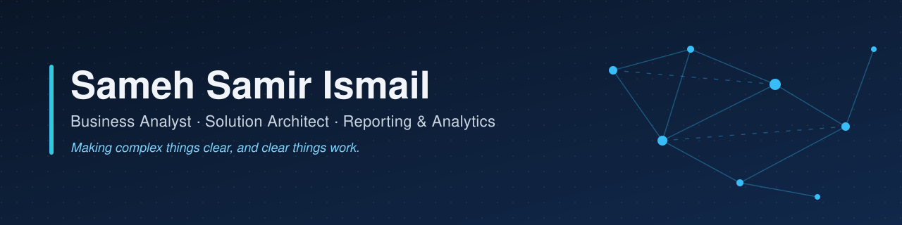

  

  
  
  

## About me

I'm a Business Analyst and Solution Architect in Riyadh. Right now I'm Manager of Reporting & Analytics Delivery at EJADA Systems. I've spent most of my career with Saudi banks, capital markets firms and government agencies. I sit down with business owners, work out what they need, write it up so engineers can build it, and stay through UAT until it goes live.

I started as a developer on Oracle CRM at SNB. Then I moved into delivery, business analysis and architecture, and later into program management on cloud and government programs. These days I spend a lot of time on Power BI and on AI agents that take the busywork out of reporting.

- Currently building Power BI operational excellence dashboards at EJADA
- Currently learning Microsoft Copilot Studio, AI agents and RAG
- Open to Senior Business Analyst, Solution Architect and Business Architect roles in banking, fintech and government
- Arabic (native), English (full professional), French (basic)

## What I work with

### Business analysis and architecture

  
  
  
  
  
  
  
  

### Data, reporting and AI

  
  
  
  
  
  
  
  
  

### Platforms and tools

  
  
  
  
  
  

### Cloud and code

  

## Projects and milestones

### EJADA Systems, 2018 to now

- Operational Excellence dashboards, EJADA (2026). A set of Power BI dashboards for revenue, sales pipeline and portfolio performance, used by managers across the company. The repo is private and internal, so the code isn't here.
- SASO electronic portal for industrial facilities (2024 to 2026). Program manager for a government portal where Saudi factories apply for and manage their ISO certificates. It's live at [ie.saso.gov.sa](https://ie.saso.gov.sa).
- General Court of Audit, Cloud Advance program (2025). Ran PMO governance across several vendor teams. We delivered disaster recovery for production apps and moved non-production workloads to the Edarat cloud.
- Al Rajhi Bank cloud migration (2023 to 2024). Program manager for moving production banking workloads to the OCS cloud platform, with no unplanned downtime.
- Bank Al Jazira (2020 to 2023). Senior Business Analyst and Solution Architect across Retail, Operations and Compliance initiatives. I redesigned core banking processes from gap analysis through UAT.
- Al Rajhi Bank Jordan, CRM digital channels (2019). Led the Microsoft Dynamics CRM rollout, which included a customer chatbot and social media integration.
- SNB Capital (2016 to 2019). Delivered the Audit Issues Tracking System (MKInsight), the CMA Circular Management portal for compliance, the CEO-level MIS Portal, the Corporate Savings Platform for Aramco subsidiaries, and the Charles River IMS rollout for buy-side operations. I also worked on an OFSAA Fund Transfer Pricing project.

### Before that

- SNB, Oracle CRM (2005 to 2016). Started as a developer customizing Oracle Applications CRM. I wrote forms, reports and web services that connected CRM to the core banking systems, and later led the releases.
- Junction 2018, Finland. Second place in the mobility track of the Car UX hackathon with CARNECTED, a mobile app that lets drivers set their car dashboard preferences from a user profile. Built with Kanzi Studio and Kanzi Connect.
- BSc Computer Science, Alexandria University (2004).

## Certifications

Certified ScrumMaster (Scrum Alliance) · TOGAF 9 Certified (The Open Group) · ITIL Foundation v3 · Google Cloud Digital Leader · MCSD: Web Applications · Microsoft Certified Professional

Recent courses include GCP Professional Cloud Architect prep, GitHub Actions, DevOps and CI/CD, Copilot Studio and AI agents, and Power BI dashboards for projects.

## GitHub stats

  
  

  

## Get in touch

The easiest way to reach me is a message on [LinkedIn](https://www.linkedin.com/in/samehsamirismail/). I'm always happy to talk about requirements work or Power BI.
